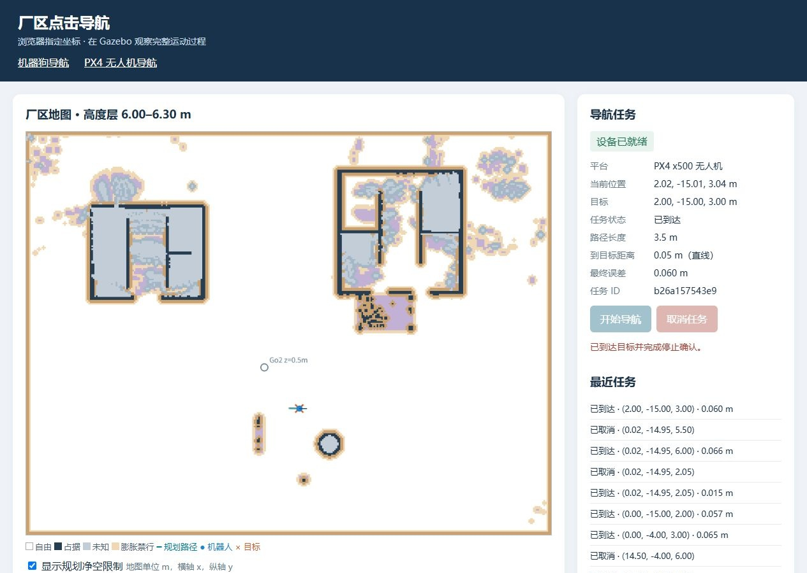

# 浏览器点击导航：Go2 机器狗 + PX4 无人机

在浏览器中指定目标，先预览路径，再让 Gazebo 中的 Go2 机器狗或 PX4 x500 无人机运动到目标。两个平台在同一个厂区世界中运行，同一时刻执行一个运动任务。

这是从 `uav_dog_plume` 中提取的独立工作空间，包含点击导航、机器狗步态控制、机器人模型、仿真世界、正式三维静态地图及测试。**不需要原项目目录，也不需要原项目的 build/install。** 仍保留 `uav_dog_nav2`、`uav_dog_sim` 等 ROS 包名，以兼容已有接口；当前规划器是自定义静态三维规划器，不是完整 Nav2 栈。

## 1. 支持环境

- Ubuntu 24.04 x86_64，ROS 2 Jazzy，Gazebo Harmonic；Windows 使用 WSL2 Ubuntu 24.04 和 WSLg。
- Python 3.12、CMake、C++ 编译工具和 colcon。
- PX4 SITL `v1.17.0`，Micro XRCE-DDS Agent `v2.4.3`。匹配的 `px4_msgs` 源码已放入仓库，不另找最新版替换。
- 默认只生成点击导航需要的 6 种 PX4 消息和 VehicleCommand 服务，消息字段未修改。完整上游消息源码保留；需要其它 PX4 接口时，使用 `PX4_MSGS_FULL_BUILD=1 bash scripts/build.sh`。
- 初次获取 PX4 源码、子模块和依赖需要网络。Git 不保存外部运行二进制和本机编译产物；按下面步骤构建，或导入同版本本地运行缓存。

先按 [ROS 2 Jazzy 官方安装说明](https://docs.ros.org/en/jazzy/Installation/Ubuntu-Install-Debs.html) 安装 ROS 并配置软件源；Gazebo 参考 [Harmonic 官方安装说明](https://gazebosim.org/docs/harmonic/install_ubuntu/)。不要混用 Gazebo Classic、ROS Humble 和本项目的 Jazzy 构建产物。

建议把 clone 放在 Linux 用户目录中，例如 `~/work/click_navigation`，减少 WSL `/mnt/d` 文件系统的编译开销及时间戳警告。Windows 的浏览器仍可访问 WSL 中的 localhost 服务。

## 2. 从 clone 到运行

项目仓库：[hxsdds/click_navigation](https://github.com/hxsdds/click_navigation)。以下命令在 Ubuntu/WSL 的 **bash 终端**执行。

当前仓库为**私有仓库**。其他使用者需要先由仓库所有者邀请为协作者，接受邀请后使用自己的 GitHub 账号完成 Git 身份验证，再执行 clone。网页可以访问仓库不代表 Ubuntu/WSL 的 Git 已登录；如提示 `Repository not found`，先检查账号是否获授权。HTTPS 验证使用 GitHub 支持的凭据管理器或个人访问令牌，不使用账号密码，也不要将令牌写入 clone 地址、脚本或提交到仓库。

```bash
git clone https://github.com/hxsdds/click_navigation.git
cd click_navigation

# 安装本项目所需的系统包；需要 sudo，ROS 软件源必须已配置
bash scripts/install_dependencies.sh

# 第一次准备 PX4 和 Agent，固定版本、源码构建，可能耗时较长
bash scripts/setup_px4.sh

# 构建本仓库的 ROS 2 包
bash scripts/build.sh

# 检查地图、消息类型、运行依赖与动态库
source scripts/env.sh
python3 scripts/doctor.py

# 运行无需启动仿真的单元测试
bash scripts/test.sh

# 启动同一世界中的机器狗、无人机和网页服务
CLICK_NAV_GUI=true bash scripts/start_click_navigation.sh
```

浏览器打开 **http://localhost:8765**。保留启动终端；使用 `Ctrl+C` 正常结束，脚本先停止导航，再清理本次仿真进程。不要同时启动旧项目的 Gazebo/PX4 或另一个点击导航实例。

### 已有同版本本地 PX4 运行缓存

如果本机已经有包含 `px4_runtime_v1.17.0` 和 `agent_system_build` 的缓存目录，可以替代上面的源码构建步骤：

```bash
bash scripts/setup_px4.sh --import /你的路径/px4_deps
bash scripts/build.sh
source scripts/env.sh
python3 scripts/doctor.py
```

导入会把所需文件**实际复制**到本项目 `_deps/`，不会建立指向原项目的链接，也不复制旧 `gz_env.sh` 中的绝对路径。仅适合同一 Ubuntu/架构以及同版本依赖。不要把 Windows 二进制当作 Linux SITL 缓存导入。

本次交付目录已准备本机运行缓存并重新编译，可直接从 `source scripts/env.sh` 和启动命令开始。**别人 clone 后不会得到被 Git 忽略的 `_deps/`、`build/`、`install/`，仍须执行准备和构建步骤。**

### 只启动一个平台 / 无 GUI

```bash
bash scripts/start_click_navigation.sh dog
bash scripts/start_click_navigation.sh drone
CLICK_NAV_GUI=false bash scripts/start_click_navigation.sh
```

单平台页面仍在 8765；双平台统一入口转发到内部 8766、8767。没有图形显示的环境用无 GUI 模式测试，浏览器照常使用。双平台内部端口不可作为自定义统一入口端口；可用 `CLICK_NAV_PORT=8780` 更换统一入口。

## 3. 浏览器怎么操作

1. 顶部选择机器狗或 PX4 无人机，等待“设备已就绪”，确认当前位置持续更新。
2. 点击地图，或在输入框指定 `x、y`；无人机还要指定**目标高度 z**。单位是米，坐标系为 `map`。
3. 点击“预览目标”。预览只检查和规划，不会立即运动。被占据、未知、净空不足或不连通的点会被拒绝。
4. 检查平面路线、三维航路与高度曲线，再点击“开始导航”。在 Gazebo 中可看到实际运动，可使用“Gazebo 跟随此机器人”。
5. 以任务状态“已到达”和最终误差确认结果。点击取消后，等待“已取消”及停稳/Hold 确认。

**无人机的“查看地图高度”只改变切片，不改变目标高度。** 普通目标 z 支持 1.2–9.3 m；层间隔为 0.3 m，例如输入查看 3 m 会显示 3.00–3.30 m 层，中心约 3.15 m。map 中 z 向上，不是距屋顶的相对高度。机器狗使用地面通行约束，主要要求 XY 到达。

初次演示可以先试机器狗 `(-1,-6)`，再试无人机 `(0,-4,3)`；目标是否可用还取决于当时的位置和另一个平台的状态。请先预览再开始。

下面是本次实际验收页面：目标 `(2,-15,3)` 已到达；查看切片仍为约 6 m，目标高度与查看高度相互独立。



## 4. 地图、控制和能力范围

- 正式地图：`config/static_navigation_map.json`，版本 `chemical_plant_v4_static11`。原始 OctoMap 0.15 m，规划网格 0.3 m。
- 已知自由、占据、未知是不同状态；未知禁止进入。平台体积和跟踪余量会进一步扩大禁行区，因此两个平台的可通行图不完全相同。
- 机器狗通过 `/control_input` 驱动 Unitree 步态控制器，当前导航速度上限 0.30 m/s、偏航速度上限 0.10 rad/s，采用停转走策略。
- 无人机由项目规划三维轨迹，PX4 负责 Offboard 设定值跟踪和飞行控制；支持静态障碍的高度绕行。
- 当前使用**冻结静态地图与 Gazebo 真值反馈**，不包含独立定位 SLAM、在线建图更新或临时/移动障碍避障。不是实机部署版本。
- 更换世界模型后不能继续沿用旧地图，系统会检查地图和世界 SHA256。不要只手工改哈希绕过验证；应使用相应建图、标定和地图验收流程重新生成数据。完整建图工具链没有包含在这份点击导航提取版中。

## 5. 测试与排查

```bash
source scripts/env.sh
bash scripts/test.sh
ros2 run rqt_graph rqt_graph
ros2 node info /click_navigation_dog
ros2 topic info /control_input --verbose
ros2 topic echo /dog/click_navigation/status --once
ros2 control list_controllers
```

仿真运行期间，可执行真实接口和运动测试（会让仿真机器人运动）：

```bash
python3 scripts/test_click_navigation_http.py --url http://localhost:8765/dog \
  --goals='-1,-6;-1,-3;-4,-6' --output test_artifacts/dog_acceptance.json

python3 scripts/test_click_navigation_http.py --url http://localhost:8765/drone \
  --goals='0,-4,3;0,-15,2' --output test_artifacts/drone_acceptance.json
```

上述两个测试应**先后运行**。测试包含无效目标拒绝、任务互斥、预览取消、运动取消和目标到达；取消测试自身也会产生运动。单平台模式下 URL 不加 `/dog` 或 `/drone`。

也可直接运行 `bash scripts/acceptance.sh dog`、`bash scripts/acceptance.sh drone`；不加参数时先后测试两个平台并审计轨迹。该入口用于已启动的双平台模式。

HTTP 测试完成且无人机已在空中时，可继续运行 `bash scripts/acceptance_ros.sh`，验证 Action、目标话题和执行/取消服务。不要在无人机仍位于地面时直接运行此接口套件。

实际轨迹可以独立复核：

```bash
python3 scripts/audit_click_navigation.py --platform dog \
  --acceptance test_artifacts/dog_acceptance.json --output test_artifacts/dog_audit.json
```

无人机对应使用 `--platform drone` 和无人机结果文件。检查使用正式地图和 SDF 障碍几何，并对记录轨迹作 3 cm 插值复核；这是对已执行轨迹的审计，不代表对任意目标的保证。

常见问题：

| 现象 | 检查方法 |
| --- | --- |
| `ros2` 找不到或自定义消息无法导入 | 在每个新终端执行 `source scripts/env.sh`，先完成 `build.sh` |
| 提示找不到 PX4 / Agent | 执行 `setup_px4.sh`；用 `doctor.py` 检查 `_deps` 和动态库 |
| Gazebo 无窗口 | 检查 WSLg/DISPLAY；可先设 `CLICK_NAV_GUI=false` 验证服务与仿真 |
| 已有 simulator / 端口占用 | 先在对应启动终端 Ctrl+C，避免直接关闭窗口留下进程 |
| 页面不就绪 | 看最新 `test_artifacts/click_navigation/shared_*` 中 world、dog、drone、px4 日志 |
| 机器狗不走 | 确认已点击开始、控制器为 active、`/odom` 与 `/trot_state` 持续更新 |
| 无人机不执行 | 检查 Agent、`/fmu/out/vehicle_status_v1`、Offboard 心跳与设定值 |
| 修改世界后地图校验失败 | 世界和静态地图必须配套，重新生成并验证地图 |
| WSL 构建很慢或 clock skew | 优先在 Linux 家目录构建，减少并行度；不要复用另一路径的 install |

## 6. 项目目录与依赖版本

```text
src/uav_dog_nav2/              网页、导航节点、地图与运动核心
src/uav_dog_sim/               Gazebo 启动集成
src/quadruped_ros2_control/    必要的 Go2 模型、硬件插件与步态控制器
src/px4_msgs/                 固定提交的 PX4 ROS 2 消息定义
scripts/                      安装、构建、启动、自检与测试
worlds/                       正式厂区世界
maps/                         正式静态地图及规划网格
config/                       地图版本与仿真配置
docs/                         提取说明与验收证据
_deps/                        本地 PX4 / Agent 运行缓存，Git 忽略
test_artifacts/               本次运行日志和测试记录，Git 忽略
```

版本见 `dependencies.lock.json`，第三方来源和许可见 [THIRD_PARTY.md](THIRD_PARTY.md)。本次独立构建和测试结果见 [docs/VALIDATION.md](docs/VALIDATION.md)。
